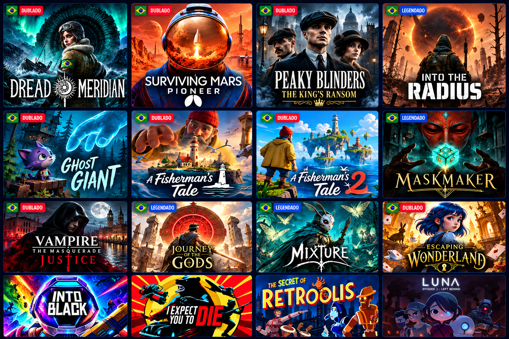

# FalaVR 🇧🇷

### Seus jogos de realidade virtual em português brasileiro.

Launcher, traduções, legendas e dublagens em um só aplicativo, diretamente no Meta Quest.

**Feito para a comunidade gamer VR • Sem fins lucrativos**

[⬇️ Baixar FalaVR 1.6](https://github.com/fabyo/falavr/releases/download/v1.6/FalaVR-1.6-release.apk) · [Todas as versões](https://github.com/fabyo/falavr/releases)

---

## 🎮 Sobre o projeto

O **FalaVR** nasceu para aproximar a comunidade brasileira dos jogos de realidade virtual, tornando suas histórias e experiências mais acessíveis para quem deseja jogar em português.

Criado por **Fabyo Guimarães Oliveira**, o projeto reúne organização de jogos, traduções, legendas e dublagens produzidas com auxílio de **inteligência artificial**, em uma iniciativa independente, **sem fins lucrativos**, voltada ao entretenimento e ao lazer.

A proposta é simples: passar menos tempo configurando e mais tempo aproveitando seus jogos.

## ✨ Recursos

### 🕹️ Launcher de jogos

Organize e abra seus jogos em uma interface visual com capas, facilitando a navegação pela sua biblioteca no Meta Quest.

### 🚀 Inicialização automática

O FalaVR inicia automaticamente com o Quest, deixando sua biblioteca de jogos sempre à mão.

### 🇧🇷 Traduções, legendas e dublagens

Encontre conteúdo em português brasileiro para os jogos compatíveis:

- **Interface e menus traduzidos.**
- **Legendas de diálogos em português.**
- **Dublagens produzidas com auxílio de inteligência artificial.**

A disponibilidade de cada recurso varia conforme o jogo e o pacote publicado.

### 📥 Instalação diretamente no Quest

Baixe e instale os pacotes de tradução e dublagem pelo próprio headset, **sem depender de computador ou conexão USB**, conforme a compatibilidade e os requisitos de ativação de cada instalação.

### 🔄 Atualizações

Receba novidades e atualizações pelo aplicativo e acompanhe os novos conteúdos disponibilizados para a comunidade.

## 💙 Um projeto da comunidade

O FalaVR é desenvolvido por quem gosta de jogar e acredita que entender a história faz toda a diferença na imersão.

Nosso objetivo é permitir que mais pessoas aproveitem os jogos de realidade virtual em português brasileiro, compartilhando esse trabalho com a comunidade de forma não comercial.

## 🤖 Uso de inteligência artificial

As traduções, legendas e dublagens disponibilizadas pelo projeto utilizam ferramentas de inteligência artificial em seu processo de produção.

Esses conteúdos são adaptações feitas por fãs. Quando não houver indicação expressa, não devem ser considerados traduções ou dublagens oficiais dos desenvolvedores.

## 📋 Compatibilidade

Antes de instalar um pacote, confira as informações e instruções apresentadas no aplicativo.

A compatibilidade pode variar conforme:

- O jogo e sua versão instalada.
- A versão do sistema do Meta Quest.
- As permissões e os requisitos do método de instalação.
- O conteúdo disponível no pacote escolhido.

## ⚖️ Respeito aos criadores

O FalaVR não distribui jogos completos, APKs ou OBBs originais. Os conteúdos de localização são destinados ao uso com uma cópia legítima do jogo.

Os jogos, marcas, personagens e materiais de divulgação pertencem aos seus respectivos titulares. O FalaVR é um projeto independente, sem vínculo oficial com a Meta ou com os estúdios dos jogos apresentados.

O caráter não comercial do projeto não substitui eventuais autorizações dos titulares dos direitos.

## 🤝 Como contribuir

Você pode ajudar o projeto:

- Relatando problemas no aplicativo ou nos pacotes.
- Informando a versão do jogo e do Quest utilizada nos testes.
- Sugerindo correções de tradução e pronúncia.
- Compartilhando sugestões e experiências com a comunidade.
- Divulgando o FalaVR e valorizando os jogos originais.

Ao abrir uma issue, descreva o problema e, quando possível, inclua os passos para reproduzi-lo.

---

**FalaVR — mais histórias para entender, mais mundos para explorar. 🇧🇷**

Um projeto independente, sem fins lucrativos, dedicado à comunidade gamer de realidade virtual.

